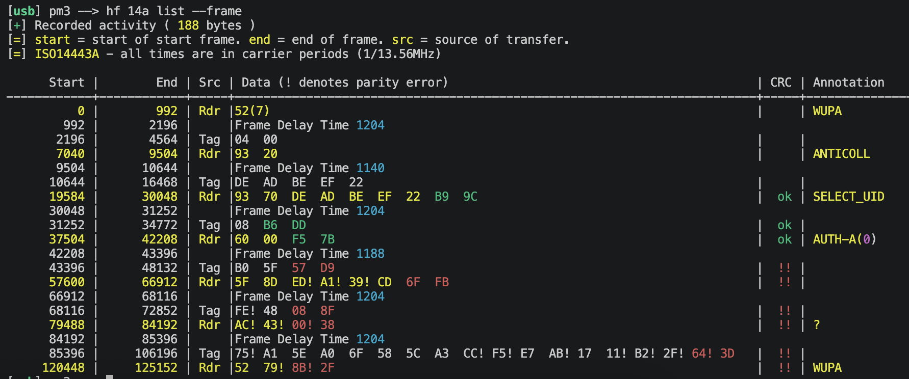

<h1 align="center">pn532-unleashed-lib</h1>

<p align="center">
  <strong>Beyond the PN532’s built-in limits</strong>
</p>

An experimental library that expands what your PN532 can do. With an RP2040
handling radio communication, it bypasses the chip’s built-in UID restrictions,
letting you emulate MIFARE Classic and NTAG tags with your own UID and memory.

It also brings **NFC-V (ISO15693) reading and emulation** to the PN532, including
ICODE SLIX and SLIX-L tags.

## Features

- **Emulate NFC-A:** Classic Mini/1K/2K/4K, NTAG213/215/216, Ultralight/EV1.
- **Read and emulate NFC-V:** ISO15693 discovery, SLIX/SLIX-L memory reads;
  generic ISO15693, SLIX and SLIX-L emulation.
- **Customize NFC exchanges:** send your own reader commands and define how an
  emulated tag responds.

## Setup

You need an **RP2040 Zero**, a **PN532 module with accessible SIGIN/SIGOUT**,
Pico SDK and Arm build tools. Select SPI or HSU on the module, use its specified
power input and connect a common ground. SIGIN/SIGOUT may require soldering.

Default pinout (RP2040 GPIO numbers). Always connect RF and ground, then choose
**SPI or HSU**:

| Connection | RP2040 | PN532 |
| --- | --- | --- |
| RF | GPIO28 (input) | SIGOUT — IC pin 35 |
| RF | GPIO29 (output) | SIGIN — IC pin 36 |
| Ground | GND | GND |
| SPI | GPIO8 | SCK |
| SPI | GPIO9 | MISO |
| SPI | GPIO10 | MOSI |
| SPI | GPIO11 | CS / SS |
| SPI | GPIO14 | IRQ |
| HSU | GPIO10 (RX) | TXD |
| HSU | GPIO11 (TX) | RXD |

[Wiring and resources →](docs/hardware.md) ·
[CMake integration and initialization →](docs/library.md)

## Emulate MIFARE Classic with your own UID

After [initialization](docs/library.md#initialize-and-read), start a Classic 1K
tag with UID `DEADBEEF` and keys A/B `FFFFFFFFFFFF`. Each row is one memory
block. Keep UID/BCC consistent when editing block 0.

The memory table is shortened with `...`; use the
[full source](examples/mifare_classic_emulator/main.c) to build and run it.

```c
#include "pn532_unleashed.h"

static const uint8_t memory[64][16] =
{
    /* Block 0: UID, BCC, SAK, ATQA, manufacturer data. */
    {0xde, 0xad, 0xbe, 0xef, 0x22, 0x08, 0x04, 0x00,
     0x08, 0x09, 0x0a, 0x0b, 0x0c, 0x0d, 0x0e, 0x0f},
    /* Blocks 1 and 2: user data. */
    {0x10, 0x11, 0x12, 0x13, 0x14, 0x15, 0x16, 0x17,
     0x18, 0x19, 0x1a, 0x1b, 0x1c, 0x1d, 0x1e, 0x1f},
    {0x20, 0x21, 0x22, 0x23, 0x24, 0x25, 0x26, 0x27,
     0x28, 0x29, 0x2a, 0x2b, 0x2c, 0x2d, 0x2e, 0x2f},
    /* Block 3: Key A, access bytes, Key B. */
    {0xff, 0xff, 0xff, 0xff, 0xff, 0xff, 0xff, 0x07,
     0x80, 0x69, 0xff, 0xff, 0xff, 0xff, 0xff, 0xff},
    ... /* Blocks 4..63 omitted. Every fourth block is a sector trailer. */
};

nfc_status_t emulate_classic(void)
{
    static const card_image_t image = {
        .model = CARD_CLASSIC_1K,
        .uid = memory[0],
        .uid_size_bytes = 4,
        .memory = &memory[0][0],
        .memory_size_bytes = sizeof(memory),
    };
    const nfc_status_t status = emulation_start(&image);
    if (status == NFC_RF_ERROR)
    {
        const nfc_status_t cleanup = nfc_stop();
        return cleanup != NFC_OK ? cleanup : status;
    }
    return status;
}
```

Call `emulate_classic()` once while RF is idle. Responses run in the RX interrupt.
Reader writes update RAM; reset loses the image.



*MIFARE Classic emulation captured with a Proxmark3.*

## Emulate NTAG with your own UID and memory

A writable NTAG213 with UID `04112233445566`. Each row is one four-byte page;
pages 0/1 contain the UID. Keep both BCC bytes consistent when changing it.
The table is shortened with `...`; use the
[full source](examples/ntag_emulator/main.c) to build and run it.

```c
#include "pn532_unleashed.h"

#include <string.h>

static const uint8_t memory[45][4] =
{
    {0x04, 0x11, 0x22, 0xbf}, /* Page 0: UID / BCC0 */
    {0x33, 0x44, 0x55, 0x66}, /* Page 1: UID */
    {0x44, 0x48, 0x00, 0x00}, /* Page 2: BCC1 / locks */
    {0xe1, 0x10, 0x12, 0x00}, /* Page 3: capability container */
    {0x10, 0x11, 0x12, 0x13}, /* Page 4: user data */
    ... /* Pages 5..44: remaining data, locks, configuration, password/PACK. */
};

static const type2_state_t state = {
    .version = {0x00, 0x04, 0x04, 0x02, 0x01, 0x00, 0x0f, 0x03},
    .tearing = {0xbd, 0xbd, 0xbd},
}; /* Synthetic signature, counters and authentication attempts are zero. */

nfc_status_t emulate_ntag(void)
{
    static uint8_t uid[7];
    memcpy(uid, memory[0], 3u);
    memcpy(&uid[3], memory[1], 4u);
    static card_image_t image = {
        .model = CARD_NTAG213,
        .uid = uid,
        .uid_size_bytes = sizeof(uid),
        .memory = &memory[0][0],
        .memory_size_bytes = sizeof(memory),
    };
    image.state.type2 = state;
    const nfc_status_t status = emulation_start(&image);
    if (status == NFC_RF_ERROR)
    {
        const nfc_status_t cleanup = nfc_stop();
        return cleanup != NFC_OK ? cleanup : status;
    }
    return status;
}
```

After initialization, call `emulate_ntag()` once while RF is idle.
Responses run in the RX interrupt.

## Emulate SLIX with your own UID and memory

An ICODE SLIX tag with 28 unlocked four-byte blocks. The table is shortened
with `...`; use the [full source](examples/slix_emulator/main.c)
to build and run it.

```c
#include "pn532_unleashed.h"

static const uint8_t memory[28][4] =
{
    {0x00, 0x01, 0x02, 0x03},
    {0x04, 0x05, 0x06, 0x07},
    ... /* Blocks 2..27 omitted. */
};
static const uint8_t locks[28] = {0};

nfc_status_t emulate_slix(void)
{
    static const uint8_t uid[8] = {0xe0, 0x04, 0x01, 0x01, 0x02, 0x03, 0x04, 0x05};
    static const card_image_t image = {
        .model = CARD_SLIX,
        .uid = uid,
        .uid_size_bytes = sizeof(uid),
        .memory = &memory[0][0],
        .memory_size_bytes = sizeof(memory),
        .state.nfcv = {
            .locks = locks,
            .block_count = 28,
            .dsfid = 0x12,
            .afi = 0x34,
            .ic_ref = 1,
        },
    };
    const nfc_status_t status = emulation_start(&image);
    if (status == NFC_RF_ERROR)
    {
        const nfc_status_t cleanup = nfc_stop();
        return cleanup != NFC_OK ? cleanup : status;
    }
    return status;
}
```

After initialization, call `emulate_slix()` once while RF is idle.
Responses run in the RX interrupt. Call `nfc_poll()` regularly from the main
loop for activity LED updates when enabled.

Complete applications: [Classic](examples/mifare_classic_emulator/README.md),
[NTAG](examples/ntag_emulator/README.md), [SLIX](examples/slix_emulator/README.md),
[SLIX/SLIX-L reader](examples/slix_reader/README.md)
and [NTAG Custom Handler](examples/ntag_custom_handler/README.md).
[Build and run examples →](examples/README.md)

## License

GPL-3.0-or-later. [LICENSE](LICENSE) · [Third-party notices](docs/licenses/NOTICE.md)
