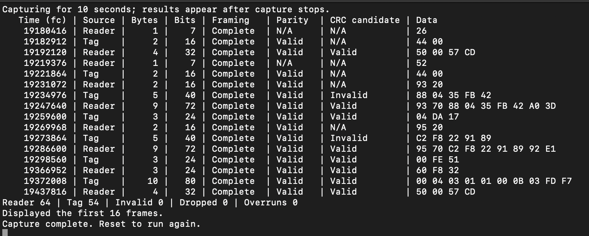

# NFC-A sniffer

Capture for ten seconds, then print the first 16 reader/tag frames and totals.
[Complete source →](main.c)

Build `nfca_sniffer` using the [shared instructions](../README.md).
Add AUX1 → GPIO0 and AUX2 → GPIO1 to the existing wiring.
Open USB stdio with DTR and press Enter when the reader and tag are ready.
Output is printed after capture stops, so printing does not delay polling.

Example output with aligned reader/tag frames, frame sizes and validation
status, followed by capture totals.

Change the AUX pins, capture duration or local frame capacity in `main.c`.
[Library usage and limits →](../../docs/sniff.md)
